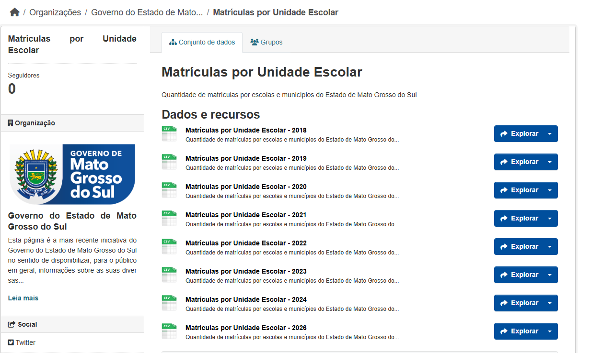
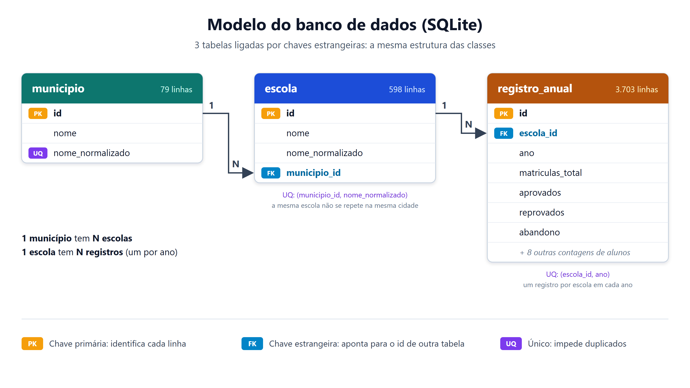

# Evolução da Educação Pública em Mato Grosso do Sul (2018–2026)

**Dados abertos, banco relacional e dashboard interativo — ODS 4**

Projeto semestral da disciplina DAC (4º semestre) da Universidade Católica Dom Bosco (UCDB).

## Sobre o projeto

Projeto que analisa os registros anuais de matrículas das escolas públicas do Estado de
Mato Grosso do Sul, aplica Ciência de Dados e responde a uma pergunta:
**a educação pública de MS está evoluindo?**

- **O que faz:** lê os arquivos de matrículas por escola publicados pelo governo do estado,
  guarda a série histórica (2018–2026) em um banco de dados e calcula as taxas de
  **aprovação**, **reprovação** e **abandono**.
- **Como mostra:** um dashboard interativo permite analisar de forma clara a educação
  **no estado em geral** e em **cada município isolado**, com filtros por município e ano.
- **Resultado:** um [artigo científico](#artigo) que descreve os dados, os desafios e as conclusões.

### Ferramentas

| Ferramenta | Para que serve |
|---|---|
| **Python** | Leitura dos CSVs, classes e estruturas de dados |
| **SQLite** | Banco relacional com a série histórica |
| **Streamlit** | Dashboard interativo com filtros |
| **Altair** | Gráficos e mapas do dashboard |

---

## Principais resultados

| Indicador | 2018 | 2023 | Variação |
|---|---|---|---|
| Taxa de aprovação | 81,3% | 88,7% | +7,3 p.p.* |
| Taxa de reprovação | 14,6% | 11,3% | −3,3 p.p. |
| Taxa de abandono | 4,0% | não disponível | — |
| Matrículas | 326.367 | 237.574 | −27,2% |

\* Parte dessa subida não é uma melhora real. Veja a explicação logo abaixo.

<a id="a-educacao-melhorou"></a>

### A educação pública de MS realmente melhorou?

**Resposta curta: sim, houve uma melhora, mas ela é moderada e menor do que os números
mostram à primeira vista.** Os dados têm erros e lacunas importantes, então **não é possível
afirmar que o sistema de educação do estado melhorou de forma significativa.**

Evolução ano a ano na rede pública (anos com resultado final):

| Ano | Aprovação | Reprovação | Abandono |
|---|---|---|---|
| 2018 | 81,3% | 14,6% | 4,0% |
| 2019 | 86,7% | 13,2% | não disponível |
| 2020 | 89,4% | 10,6% | não disponível |
| 2021 | 88,4% | 11,6% | não disponível |
| 2022 | 88,0% | 12,0% | não disponível |
| 2023 | 88,7% | 11,3% | não disponível |

**O que indica melhora**

- A **reprovação caiu** de 14,6% para 11,3%. Esse número não depende do abandono, então é a
  evidência mais segura de melhora.
- A **aprovação subiu** de 81,3% para 88,7%.

**Por que a melhora precisa ser lida com cuidado**

| Problema | Efeito no resultado |
|---|---|
| **O abandono deixou de ser registrado.** Caiu de 10.490 alunos (2018) para 158 (2019) e é zero de 2020 em diante | Sem o abandono na base, a aprovação sobe "sozinha". Calculando 2018 do mesmo jeito, a aprovação seria 84,8%, e a melhora real até 2023 fica perto de **3,9 p.p.**, não 7,3 |
| **A maior subida foi em 2019–2020**, no início da pandemia | Nesses anos muitas redes mudaram as regras de avaliação e aprovação. Os dados não permitem separar esse efeito de uma melhora real. De 2020 a 2023 a aprovação ficou praticamente estável (88% a 89,4%) |
| **O abandono só existe em 2018** | O principal indicador de permanência do ODS 4 não pode ser acompanhado |
| **Os anos mais recentes estão incompletos** | 2024 tem 84% dos alunos como "cursando", 2026 ainda não terminou e a fonte não tem 2025 |
| **Poucos anos válidos** | Só há 6 anos com aprovação válida, o que não basta para um teste estatístico da tendência |
| **As matrículas caíram 27%** | Os dados não mostram a causa (municipalização, mudança de rede ou menos crianças em idade escolar) |

**Conclusão:** os dados mostram uma melhora moderada, puxada principalmente pela queda da
reprovação. O resultado mais importante do projeto, porém, é sobre a **qualidade dos dados
abertos**: do jeito que estão publicados hoje, eles não permitem dizer com segurança se a
educação do estado está evoluindo. Mais detalhes nas seções de Resultados e Discussão do
[artigo](#artigo).

### Outros números


- **3.703** registros, **598** escolas e **79** municípios carregados, sem nenhuma divergência entre o banco e os CSVs.
- A busca por município e ano no **hash** foi cerca de **1.400 vezes mais rápida** que a busca em lista.

## Artigo

O projeto gerou um artigo científico:
**"Evolução da Educação Pública em Mato Grosso do Sul (2018–2026): Dados Abertos, Banco
Relacional e Dashboard Interativo"**.

O artigo explica como os dados foram carregados e validados, os problemas encontrados na
fonte (falta de código da escola, acentuação inconsistente, abandono não registrado a partir
de 2020) e os resultados da análise das taxas de aprovação, reprovação e abandono.

- 📄 [Ler o artigo em PDF](docs/artigo/artigo.pdf)
- ✏️ [Projeto no Overleaf](https://pt.overleaf.com/project/6ae26c556fca9830f3262182)
- 🗂️ Código-fonte LaTeX: [`docs/artigo/`](docs/artigo/)

## Perguntas frequentes

Clique em uma pergunta para ir direto à resposta.

**Sobre os resultados**

- [A educação pública de MS realmente melhorou?](#a-educacao-melhorou)
- [De onde vêm os dados?](#dados)
- [Os dados são confiáveis? Que problemas foram encontrados?](#problemas-nos-dados)
- [Por que alguns anos aparecem como "não disponível"?](#anos-validos)
- [Como as taxas são calculadas?](#metricas)

**Sobre a parte técnica**

- [Como o banco de dados (SGBD) foi aplicado no projeto?](#banco-de-dados)
- [Por que SQLite, e não outro SGBD?](#por-que-sqlite)
- [Onde aparece a Orientação a Objetos?](#orientacao-a-objetos)
- [Quais estruturas de dados foram usadas, e por quê?](#estruturas-de-dados)
- [Por que o projeto não usa pandas?](#por-que-sem-pandas)
- [O que o dashboard mostra?](#dashboard)
- [Como saber se a carga dos dados está correta?](#validacao)
- [Como rodar o projeto?](#como-executar)
- [Quais são as limitações do projeto?](#limitacoes)

## Dados

Fonte: [Portal de Dados Abertos de MS — Matrículas por Unidade Escolar](https://www.dados.ms.gov.br/dataset/matriculas-por-unidade-escolar)

[](https://www.dados.ms.gov.br/dataset/matriculas-por-unidade-escolar)

*Página do portal onde os oito arquivos CSV foram baixados (clique na imagem para abrir).*

São oito arquivos CSV, um por ano (2018 a 2024 e 2026; **a fonte não tem 2025**), todos com as
mesmas colunas. Cada linha é uma escola em um ano.

| Ano | Escolas | Matrículas |
|---|---|---|
| 2018 | 485 | 326.367 |
| 2019 | 475 | 293.195 |
| 2020 | 441 | 242.028 |
| 2021 | 442 | 248.780 |
| 2022 | 472 | 247.646 |
| 2023 | 467 | 237.574 |
| 2024 | 461 | 220.926 |
| 2026 | 460 | 199.489 |

<a id="problemas-nos-dados"></a>

### Problemas encontrados nos dados

| Problema | Como foi tratado |
|---|---|
| Não existe código da escola (INEP) | A escola é identificada pelo par (município, nome da escola) |
| Acentuação inconsistente ("Água Clara", mas "Anastacio") | Regra fixa de normalização: tira acentos, `upper()` e remove espaços repetidos |
| Escolas com aprovados + reprovados + abandono = 0 (ex.: CEEJA) | A taxa fica indefinida (`None` / `NULL`), nunca causa erro nem vira 0% |
| Abandono caiu de 10.490 (2018) para 158 (2019) e é zero de 2020 em diante | Taxa de abandono usada só em 2018 |
| 2024 tem 84% dos alunos como "cursando"; 2026 ainda não terminou | Taxas de aprovação e reprovação usadas só de 2018 a 2023 |

<a id="anos-validos"></a>

Anos válidos para cada indicador (a regra fica no `src/banco.py`, então vale para qualquer consulta):

| Indicador | Anos usados |
|---|---|
| Matrículas | 2018–2026 |
| Aprovação e reprovação | 2018–2023 |
| Abandono | 2018 |

Fora desses anos, o dashboard mostra **"não disponível"**. Mais detalhes em [`docs/anos_validos.md`](docs/anos_validos.md).

<a id="metricas"></a>

## Métricas

Seguindo o padrão do INEP, a base é formada só pelos alunos com situação final:

```
base             = Aprovados + Reprovados + Abandono
taxa_aprovacao   = Aprovados  / base * 100
taxa_reprovacao  = Reprovados / base * 100
taxa_abandono    = Abandono   / base * 100
```

Ao agrupar escolas (por município ou pelo estado), as contagens são **somadas primeiro** e a
divisão é feita uma vez só. Não fazemos a média das taxas das escolas, porque isso daria o mesmo
peso a uma escola com 50 alunos e a uma com 2.000.

## Como o sistema funciona

```
8 arquivos CSV ──► lista de dicionários ──► objetos + hashes ──► SQLite ──► dashboard
  (leitor_csv)        (csv.DictReader)        (estruturas)       (banco)    (Streamlit)
```

<a id="por-que-sem-pandas"></a>

### Por que sem pandas?

A carga usa só a biblioteca padrão do Python (`csv`, `unicodedata`, `sqlite3`), sem pandas. O
objetivo do projeto é mostrar **como** os dados são lidos, organizados e guardados. Com pandas,
a leitura, as classes e as estruturas de dados ficariam escondidas dentro da biblioteca. Assim,
elas ficam visíveis no código.

<a id="orientacao-a-objetos"></a>

### Orientação a objetos

Classes `Municipio`, `Escola` e `RegistroAnual` (em `src/modelos.py`), ligadas nos dois sentidos:
do município se chega aos registros, e do registro se chega ao município. Cada linha do CSV vira
um objeto `RegistroAnual`. A classe `Totais` (em `src/estruturas.py`) soma as contagens e calcula
as taxas.

<a id="estruturas-de-dados"></a>

### Estruturas de dados

| Estrutura | Para que serve |
|---|---|
| **Lista** de dicionários | Guarda as linhas lidas dos CSVs, na ordem do arquivo |
| **Hash** `{(municipio, escola): Escola}` | Garante que cada escola seja criada uma só vez, mesmo aparecendo em vários anos |
| **Hash** `{(municipio, ano): Totais}` | Responde aos filtros de município e ano em O(1) |

A busca no hash foi cerca de **1.400 vezes mais rápida** que a busca na lista, que precisa
olhar linha por linha (O(n)). Para medir: `python src/comparar_busca.py`.

<a id="banco-de-dados"></a>

### Banco de dados relacional (SGBD)

O banco SQLite (`dados/dac.db`) guarda toda a série histórica e é a **única fonte** que o
dashboard consulta.



O banco é usado em quatro pontos:

1. **Modelagem** — três tabelas ligadas por chaves estrangeiras (`PRAGMA foreign_keys = ON`):
   ```
   municipio(id, nome, nome_normalizado UNIQUE)
   escola(id, nome, nome_normalizado, municipio_id FK, UNIQUE(municipio_id, nome_normalizado))
   registro_anual(id, escola_id FK, ano, ...11 contagens, UNIQUE(escola_id, ano))
   ```
   Um município tem várias escolas, e uma escola tem um registro por ano.
2. **Carga idempotente** — todas as inserções usam `INSERT OR IGNORE`. Junto com as restrições
   `UNIQUE`, isso garante que rodar a carga duas vezes não duplica nada.
3. **Consultas de validação** — conferem a contagem por ano com os CSVs e as regras de soma
   (veja [Validação](#validacao)).
4. **Consultas analíticas** — calculam as taxas por município e ano e a evolução do estado com
   `JOIN`, `GROUP BY` e `SUM`. A divisão usa `NULLIF` para evitar divisão por zero, e a regra dos
   anos válidos fica no próprio SQL (`src/banco.py`). Assim, qualquer consulta ao banco, com ou
   sem o dashboard, mostra os mesmos números.

<a id="por-que-sqlite"></a>

**Por que SQLite?** O banco inteiro fica em um arquivo só, não precisa instalar nem configurar
um servidor e já vem com o Python (`sqlite3`). Para cerca de 3.700 registros, ele é mais que
suficiente. Como o schema usa SQL padrão (chaves estrangeiras, `UNIQUE`, `JOIN`), seria simples
migrar para um SGBD com servidor, como PostgreSQL ou MySQL, se o volume de dados crescer.

<a id="dashboard"></a>

### Dashboard

Feito com Streamlit e Altair. Tem filtro de município (com a opção "Todo o MS") e de ano,
cartões que comparam o ano escolhido com 2018, mapa de MS, gráfico de evolução, mapa de calor
município × ano, ranking dos municípios e uma seção explicando por que 2024 e 2026 não têm taxa.

## Estrutura de pastas

```
Dac-4sem/
├── dados/
│   ├── csv/                      # um CSV por ano
│   ├── geo/ms-municipios.json    # contorno dos municípios para o mapa
│   └── dac.db                    # banco SQLite gerado pela carga
├── src/
│   ├── leitor_csv.py             # leitura dos CSVs
│   ├── normalizacao.py           # normalização de nomes
│   ├── modelos.py                # classes Municipio, Escola, RegistroAnual
│   ├── estruturas.py             # hashes, classe Totais e busca em lista
│   ├── banco.py                  # schema, carga e consultas SQL
│   ├── validar.py                # relatório de validação da carga
│   └── comparar_busca.py         # comparação de tempo: lista vs. hash
├── tests/                        # testes automatizados (unittest)
├── docs/                         # artigo (PDF e LaTeX), diagrama e anotações
├── streamlit_dashboard_app.py    # dashboard
└── requirements.txt
```

## Como executar

Requisitos: Python 3 (testado com Python 3.14 no Windows 10).

```bash
# 1. Baixar o projeto
git clone https://github.com/enzo-pasini/Dac-4sem.git
cd Dac-4sem

# 2. Instalar as dependências (Streamlit e Altair)
pip install -r requirements.txt

# 3. (Opcional) Recriar o banco a partir dos CSVs
python src/banco.py

# 4. Abrir o dashboard
streamlit run streamlit_dashboard_app.py
```

O banco `dados/dac.db` já vem no repositório, então o passo 3 só é necessário se os CSVs mudarem.
Rodar a carga de novo é seguro, porque ela não duplica dados.

Outros comandos úteis:

```bash
python -m unittest discover -s tests -v   # roda os 33 testes
python src/validar.py                     # confere banco vs. CSVs e as regras de soma
python src/comparar_busca.py              # mede o tempo da busca em lista vs. hash
```

<a id="validacao"></a>

## Validação

- Testes automatizados cobrem leitura, normalização, classes, hashes e banco.
- Consultas SQL de validação retornam **só as linhas com erro** (zero linhas = tudo certo):
  - contagem de registros por ano no banco = contagem nos CSVs;
  - `MatriculasTotal = MatriculaInicial + MatriculaAposCenso`;
  - `MatriculasTotal` = soma das oito situações finais.
- Rodar a carga duas vezes mantém 79 municípios, 598 escolas e 3.703 registros.

<a id="limitacoes"></a>

## Limitações

- A fonte não tem o ano de 2025 nem a etapa de ensino (fundamental ou médio).
- O abandono só pode ser analisado em 2018.
- Uma escola que mudou de nome entre os anos é contada como duas escolas diferentes.
- Há poucos anos válidos para um teste estatístico da tendência.

## Trabalhos futuros

- Usar o código INEP das escolas, para não depender do nome.
- Cruzar com o Censo Escolar para recuperar o abandono.
- Separar os indicadores por etapa de ensino.
- Atualizar a carga quando os resultados de 2024 a 2026 forem publicados.

## Autores

Enzo Pasini, Lucas Fiaes, Victor Hugo, Mike Weyller e Davi Ribeiro.
Orientação: Prof. Renato Gil — Universidade Católica Dom Bosco, Campo Grande/MS.
